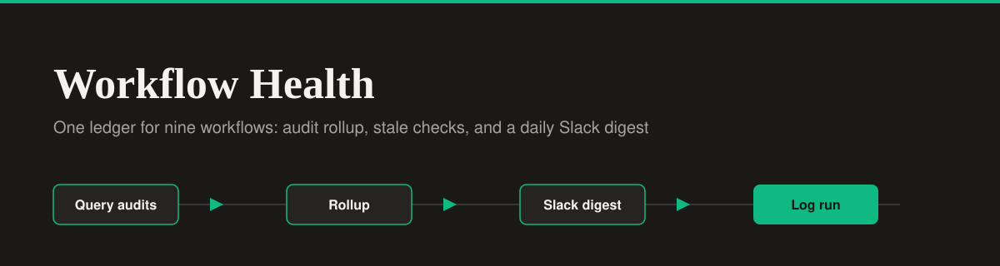

<div align="center">




</div>

# Workflow Health - System Health Monitor

A premium B2B observability dashboard that acts as the UI layer for an n8n meta-workflow. This app visualizes the logic of **Workflow 10 (Portfolio Health Monitor)** by simulating the aggregation of audit logs from 9 separate workflows and generating a daily Slack digest.

**Live Demo:** [workflow-health.lovable.app](https://workflow-health.lovable.app)

## n8n Workflow Reference

This UI is designed to accompany a self-hosted n8n automation. You can view the actual backend workflow code and documentation in my platform integration portfolio:

- **Repository:** [platform-integration-portfolio](https://github.com/Xhenzouu/platform-integration-portfolio)
- **Workflow Documentation:** [Workflow 10: Portfolio Health Monitor](https://github.com/Xhenzouu/platform-integration-portfolio/blob/main/docs/workflows/10-portfolio-health-monitor.md)
- **Raw Workflow JSON:** [portfolio-health-monitor.json](https://github.com/Xhenzouu/platform-integration-portfolio/blob/main/workflows/portfolio-health-monitor.json)

The n8n workflow handles the following logic:

1. Queries audit tables from 9 different workflows using a UNION ALL query to normalize their schemas.
2. Computes a rollup, grouping by workflow and flagging any that are "stale" (0 runs in 24 hours).
3. Builds a Slack Block Kit digest separating workflows into "Healthy" and "Needs Attention".
4. Posts the digest to a Slack channel and logs the run to Supabase.

This dashboard visualizes that exact flow: the Ledger shows the health of all 9 workflows, and the right-side drawer displays the normalized schema data and the generated Slack digest.

## Features

- **Dual Themes:** Full Light and Dark mode support with a toggle switch.
- **Observability Metrics:** A 4-column KPI grid showing Total Workflows, Healthy, Needs Attention, and Stale.
- **The Ledger:** An editorial-style data table that lists workflows with their last run time, run count, and a color-coded status pill.
- **Detail Drawer:** Clicking a row opens a side panel with the normalized schema data and a mock Slack digest preview.
- **Premium UI:** Strict flat design, stark borders, and no gradients.

## Run Locally

1. Clone the repo:

   ```bash
   git clone https://github.com/Xhenzouu/workflow-health.git
   cd workflow-health
   ```

2. Install dependencies:

   ```bash
   npm install
   ```

3. Start the development server:

   ```bash
   npm run dev
   ```
